# Desktop RAM Configuration and Validation

## Objective

Configure the installed Kingston DDR4 memory to operate at its rated 3200 MT/s transfer rate and assess stability using MemTest86.

## Project Outcome

**Result: PASS**

Configured Kingston DDR4 memory from its initial 2400 MT/s operating speed to 3200 MT/s using XMP Profile 1, then validated it with a four-pass MemTest86 run.

| Measurement | Result |
|---|---|
| Memory | 32 GB Kingston DDR4 (2 × 16 GB) |
| Initial speed | 2400 MT/s |
| Tested speed | 3200 MT/s |
| Timings | 16-18-18-36 |
| DRAM voltage | 1.35 V |
| Tests passed | 48/48 (100%) |
| Memory errors | 0 |
| ECC errors | 0 |
| Test duration | 4 h 6 min 31 sec |

The test completed without reported errors under the tested configuration. However, this does not guarantee stability under every possible workload.
ECC errors: 0 reported by MemTest86. The installed RAM is non-ECC, so this test does not validate ECC error-correction functionality.

## Test Environment

| Component | Details |
|---|---|
| CPU | AMD Ryzen 5 5600X, 6 cores / 12 threads |
| Motherboard | ASRock B550M PG Riptide |
| BIOS version | P3.90 |
| Memory | 32 GB Kingston DDR4, 2 × 16 GB |
| Memory model | KF3200C16D4/16GX |
| Operating system | Ubuntu 26.04.1 Desktop |
| Memory diagnostic tool | PassMark MemTest86 Free |
| MemTest86 version | 11.7 |

## Initial Configuration

The memory was initially operating at 2400 MT/s with the BIOS memory setting on Auto.

## Evidence 1 — Initial Configuration

The following screenshots document the memory configuration before enabling XMP Profile 1.

### Initial BIOS configuration

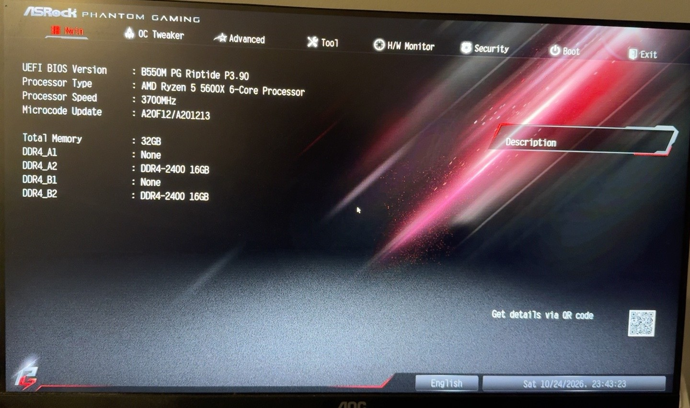

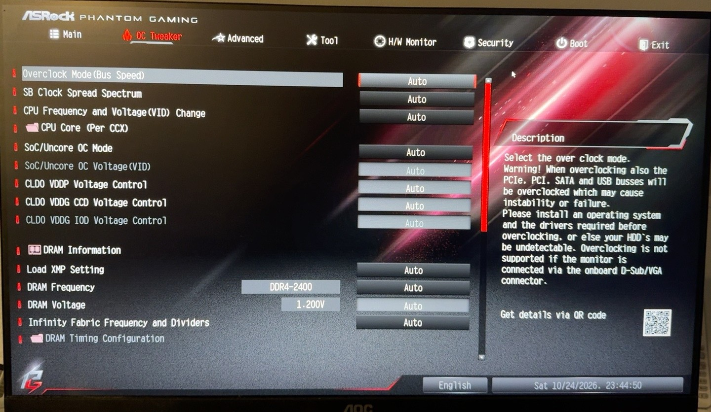

### Initial MemTest86 configuration

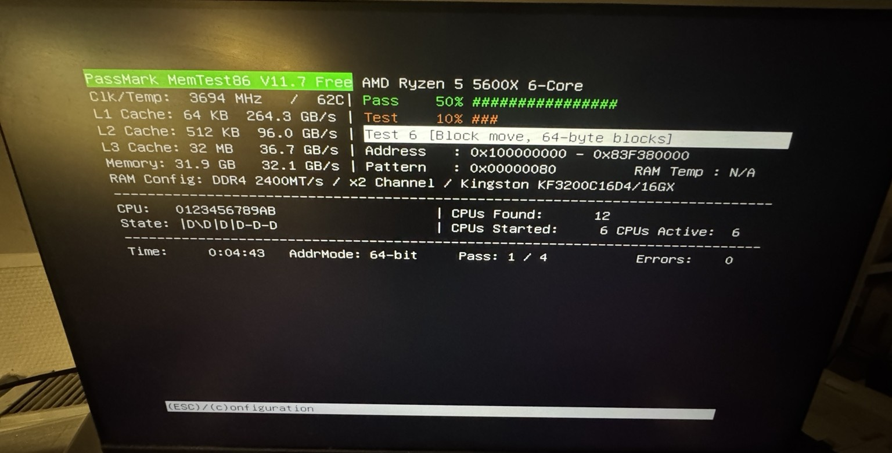

The initial memory operating speed was recorded as 2400 MT/s with the BIOS memory setting on Auto. These screenshots establish the baseline for comparison with the subsequent XMP Profile 1 configuration.

## Configuration Change

XMP Profile 1 was selected in UEFI/BIOS.

The profile specifies:
- Transfer rate: DDR4-3200 MT/s
- Timings: 16-18-18-36
- DRAM voltage: 1.35 V

## Evidence 2 — XMP Profile 1 Configuration

XMP 2.0 Profile 1 specifies DDR4-3200 MT/s, timings of
16-18-18-36 and a DRAM voltage of 1.35 V.

### BIOS Profile Selection

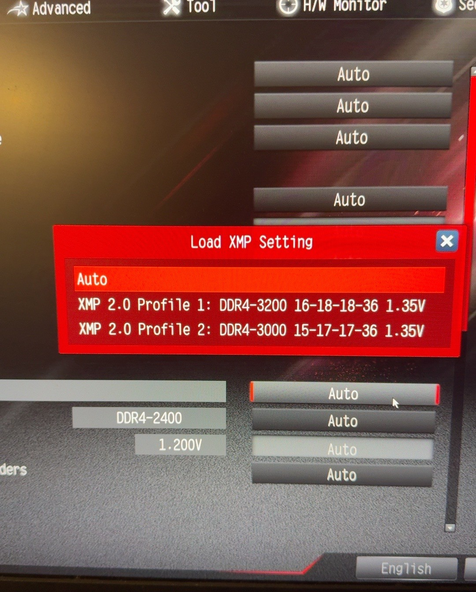

This photograph records the BIOS profile-selection menu and the
available XMP profiles. Auto is highlighted in this capture;
the subsequent MemTest86 screenshot confirms operation at 3200 MT/s.

### Confirmed XMP Profile 1 Settings

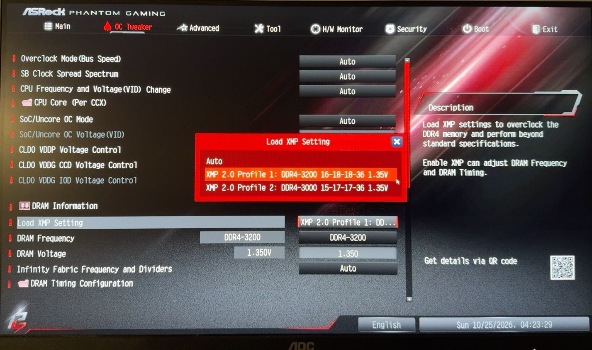

The BIOS screenshot confirms that XMP 2.0 Profile 1 is selected.
The displayed configuration is DDR4-3200 MT/s, timings of
16-18-18-36 and a DRAM voltage of 1.35 V.

### MemTest86 — Intermediate Result 1

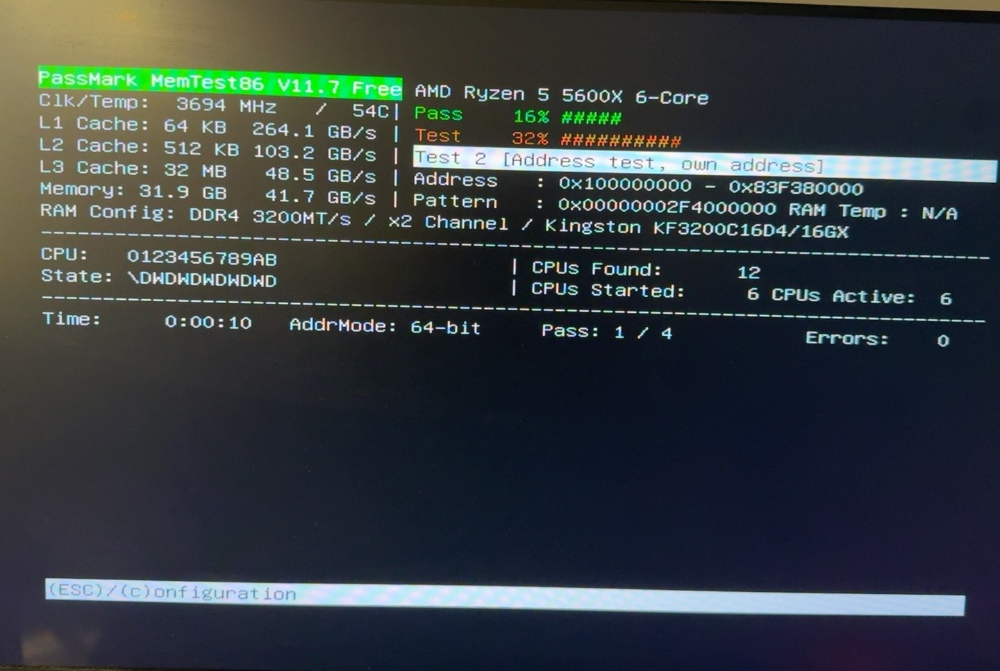

### MemTest86 — Intermediate Result 2

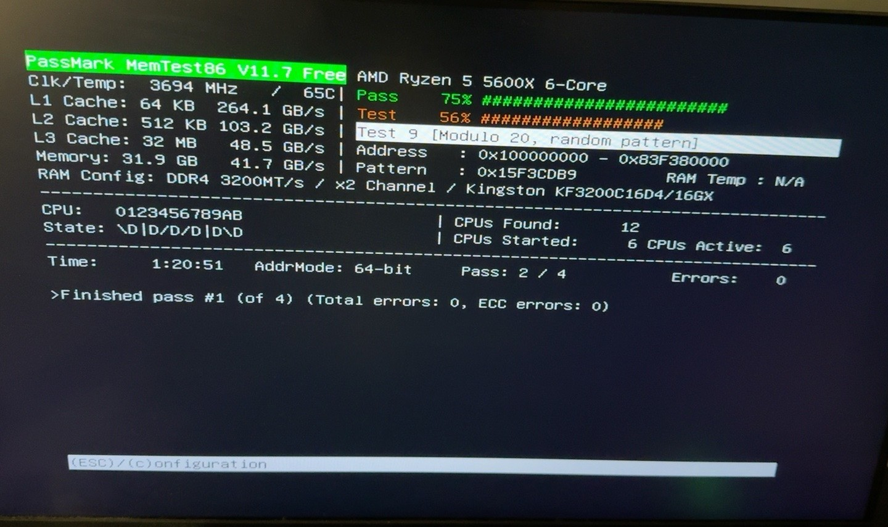

### MemTest86 — Intermediate Result 3

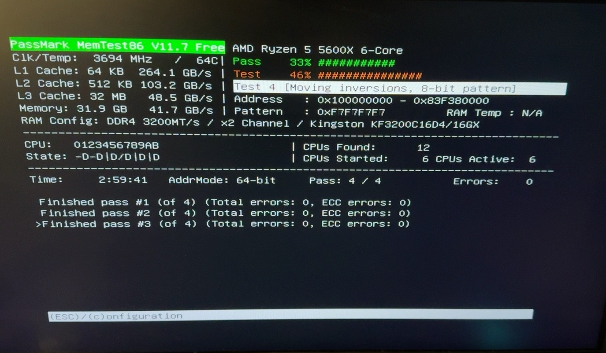

At the time of these captures, MemTest86 reported zero errors.

The four-pass test subsequently completed with 48 of 48 tests passed and zero reported memory or ECC errors. The detailed results are documented below.

## Validation Procedure

1. Boot MemTest86 from USB media.
2. Confirm the detected memory capacity and operating speed.
3. Run the planned four-pass memory test.
4. Monitor the reported error count.
5. Record the final results before drawing a conclusion.

## Results

**Status: PASS**

- **Diagnostic tool:** PassMark MemTest86 Free v11.7
- **CPU:** AMD Ryzen 5 5600X, 6 cores / 12 threads
- **Memory:** 32 GB Kingston DDR4, 2 × 16 GB
- **Operating speed:** DDR4-3200 MT/s, dual-channel
- **Timings:** 16-18-18-36
- **MemTest86 passes completed:** 4 of 4
- **Tests passed:** 48 of 48 (100%)
- **Memory errors:** 0
- **ECC errors:** 0
- **Elapsed time:** 4 hours, 6 minutes, 31 seconds
- **Test start:** 24 October 2026, 23:48:50

### Final Test Evidence

#### Completed Test

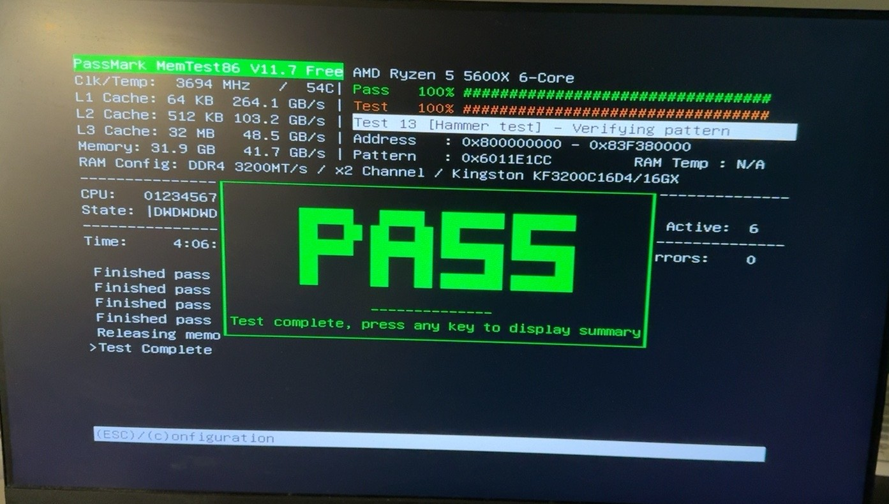

#### Detailed Result Summary

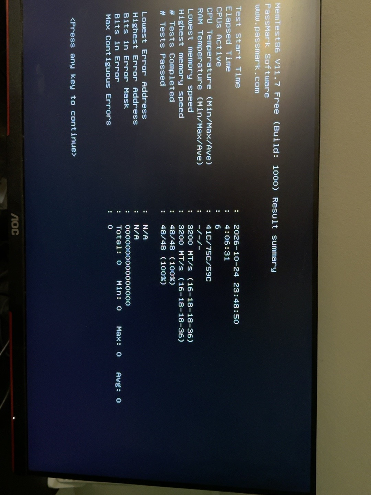

The four-pass test completed without reported memory errors at DDR4-3200 MT/s. This provides evidence of stability under the test conditions used, but does not guarantee stability under every possible workload.

### Per-Test Error Summary

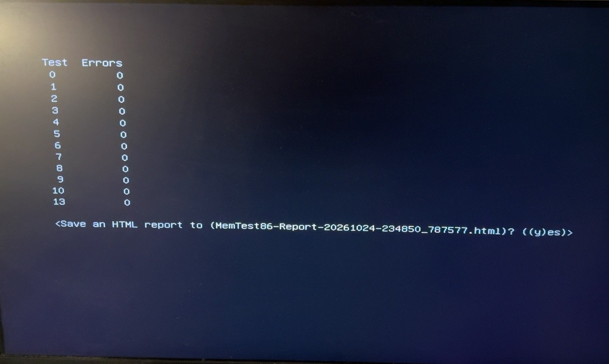

The MemTest86 error summary reports zero errors for tests 0–13.
Together with the completed four-pass result, this supports the
conclusion that the memory passed the diagnostic under the tested
configuration.

## Conclusion

The Kingston 32 GB DDR4 memory kit completed all four MemTest86 passes at 3200 MT/s with zero reported errors.

The test supports the decision to run the memory at its rated transfer rate using XMP Profile 1 rather than the initial 2400 MT/s Auto configuration.

This result is a positive validation milestone, not a guarantee against all future memory-related faults. Normal system use and further testing under different workloads can provide additional confidence.

## Lessons Learned

- Recording the initial configuration establishes a useful baseline.
- XMP can enable the memory's rated transfer rate when supported by the hardware.
- A longer diagnostic test provides more evidence than a short test alone.
- Screenshots and measured results make technical documentation easier to verify and reproduce.
- Configuration changes should be validated before treating them as stable.

