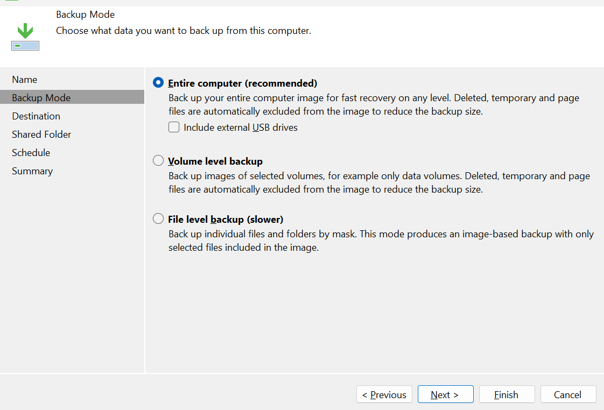
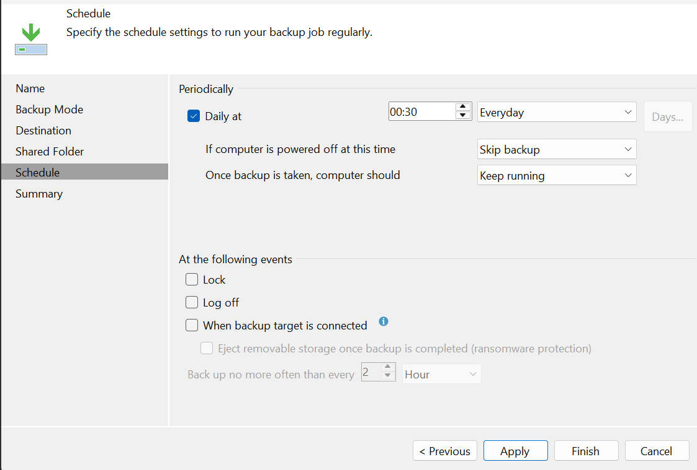
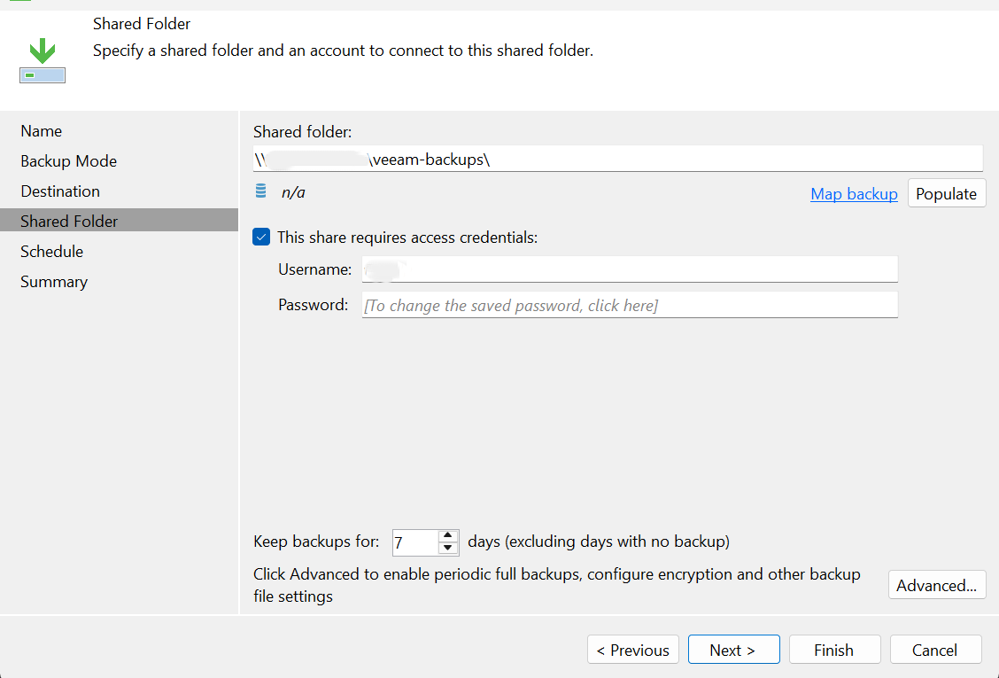
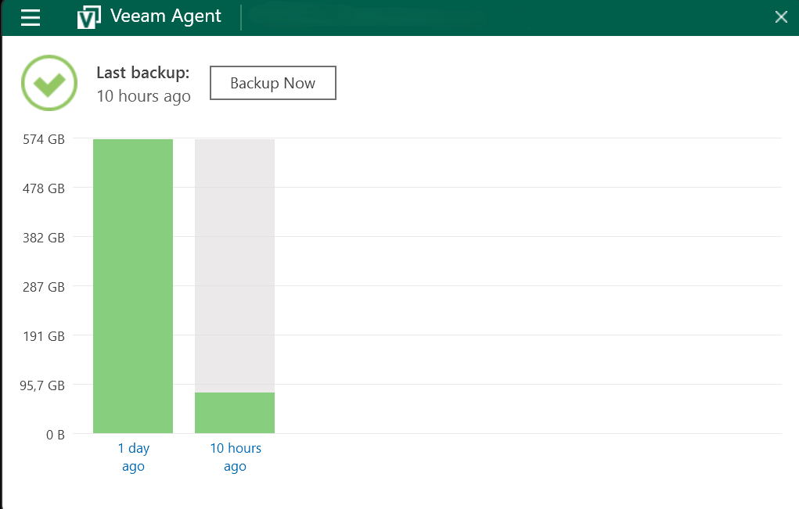

# Windows PC Backup to NAS Using Veeam

## Project Overview

This project documents the configuration of whole-computer backups from a Windows 11 Pro PC using Veeam Agent for Microsoft Windows, with backup data stored on a network-attached storage (NAS) system.

The backup destination is a shared folder hosted by OpenMediaVault (OMV) on a Debian server. The backup files are stored on an 18 TB WD enterprise hard drive connected to the server.

The project also documents a storage-capacity challenge, an unsuccessful attempt to continue the existing backup chain at the new destination, and the setup of a new backup job targeting the NAS.

## Objectives

- Configure whole-computer backups of a Windows 11 Pro PC.
- Store backup data on a network share hosted by the NAS.
- Configure a daily backup schedule.
- Investigate storage-capacity constraints and backup-chain migration issues.
- Document the resulting configuration and lessons learned.
- Validate file-level recovery and document the outcome.

## Lab Environment

| Component | Configuration |
|---|---|
| Backup source | Windows 11 Pro |
| Backup software | Veeam Agent for Microsoft Windows 13.1.1 (build 13.1.1.700) |
| NAS operating system | Debian GNU/Linux 13.7 (Trixie) |
| NAS management | OpenMediaVault 8.5.12 (Synchrony) |
| Backup destination | NAS network share |
| Storage device | 18 TB WD enterprise HDD in TerraMaster D4-320 DAS |
| Schedule | Daily |

## Architecture

The backup workflow is:

1. Veeam Agent runs on the Windows PC.
2. The agent performs the configured whole-computer backup.
3. Backup data is written to a shared folder hosted by the Debian/OMV server.
4. The backup files are stored on the 18 TB WD enterprise hard drive.

## Challenge and Troubleshooting

The original backup job used an external drive with limited available capacity. As the backup files and maintenance operations consumed additional space, managing the available capacity became a concern.

The existing backup chain was copied to a new location, but the attempt to continue using that chain at the new destination did not work as intended.

Rather than claiming a successful migration, this project records the outcome accurately: a new backup job was created to target the NAS share.

## Current Status

The new daily backup job is operational, with backup data written to the NAS share on the 18 TB WD hard drive.

**Recovery validation:** A file-level restore test and verification of the restored file will be documented once completed.

## Lessons Learned

- Plan storage capacity with backup growth and maintenance operations in mind.
- Treat moving backup files and successfully continuing an existing backup chain as separate tasks.
- Verify the status of a new backup job rather than assuming that copied backup files guarantee continuity.
- Test recovery, because a successful backup run alone does not demonstrate that files can be restored.

## Evidence and Documentation

The following screenshots document the backup configuration, schedule, NAS destination, and recent backup status. Sensitive information has been redacted before publication.

### 1. Whole-Computer Backup Configuration

The backup mode is configured as **Entire computer**, providing an image-based backup of the Windows PC.

### 2. Daily Backup Schedule

The job is configured to run daily at 00:30. The displayed settings specify that the backup is skipped if the computer is powered off at the scheduled time.

### 3. NAS Backup Destination

The job is configured to use an SMB shared folder on the NAS. The destination path and account details have been partially redacted for privacy.

### 4. Recent Backup Status

The Veeam Agent dashboard displays a green status indicator and reports the time elapsed since the last backup. This provides a snapshot of the reported backup status; detailed session history and recovery testing are separate validation steps.

### Recovery Validation

A file-level restore test and verification of the restored file will be documented once completed.
