# Windows 11 and Ubuntu Dual Boot: Secure Boot, LUKS and BitLocker Troubleshooting

**Project type:** Personal lab / operating-system installation and troubleshooting  
**Status:** Completed; evidence and limitations are documented below.

This project documents a real dual-boot setup on a Lenovo Legion laptop. The main challenge was a key-related boot error when attempting to start Ventoy with Secure Boot enabled. The work then covered preparation of the NVMe drive, installation of Windows and Ubuntu on the same drive, Ubuntu LUKS encryption, UEFI boot entries, and a separate Windows TPM/BitLocker issue.

The project records what was observed and tested. It does not claim that the exact cause of every error was conclusively identified.

## Objectives

- Investigate a Ventoy boot issue encountered while Secure Boot was enabled.
- Prepare the NVMe drive for a clean Windows and Ubuntu installation.
- Install Windows first while deliberately reserving space for Ubuntu.
- Install Ubuntu alongside Windows Boot Manager and enable LUKS encryption.
- Inspect the installed Linux storage and UEFI boot configuration.
- Troubleshoot an initial BitLocker/TPM error and verify the final encryption status.
- Re-enable Secure Boot and test both operating systems.

## Lab environment

| Component | Configuration |
|---|---|
| Laptop | Lenovo Legion 5 16IRX9 |
| CPU | Intel Core i9-14900HX |
| Memory | 32 GB DDR5 |
| Graphics | NVIDIA GeForce RTX 4070 Laptop GPU |
| Internal drive | Approximately 1 TB SK hynix NVMe SSD (953.9 GB displayed by setup tools) |
| Firmware | UEFI; photographed BIOS version NMCN35WW |
| Windows | Windows 11; initially installed as Home and later upgraded to Pro |
| Linux | Ubuntu 26.04.1 LTS |
| Boot/media tools | Ventoy 1.1.18, Parted Magic 26.10.3, PassMark MemTest86 Free 11.7 |
| Verification tools | `mokutil`, `efibootmgr`, `lsblk`, `nvidia-smi`, Windows PowerShell and `manage-bde` |

Personal and device-specific identifiers have been redacted from the public evidence copies where they were not necessary to explain the configuration.

## Troubleshooting and installation timeline

### 1. Ventoy boot attempt and MemTest86 workaround

The initial BIOS photograph shows Secure Boot enabled. I first attempted to start MemTest86 from the Ventoy USB but encountered a key-related boot error. I did not capture a photograph of that exact error, so this part of the timeline is recorded from my notes rather than a screenshot of the failure.

I then flashed a separate USB drive with MemTest86. That media booted while Secure Boot was still enabled. MemTest86 Free v11.7 ran for just over an hour. The captured result shows two completed passes, progress into the next pass, 27 of 48 tests completed overall, and zero reported errors. The test was stopped before the planned four-pass run completed; it must therefore be treated as **incomplete**, not as a full memory validation.

I subsequently entered the UEFI/BIOS and temporarily disabled Secure Boot. I did not take a photograph while the setting was disabled; this action is documented from my account of the process.

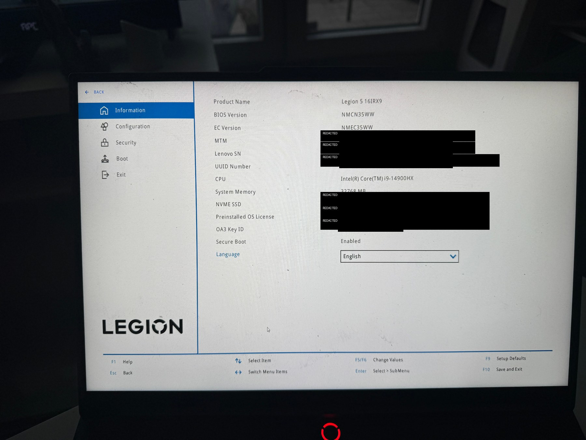

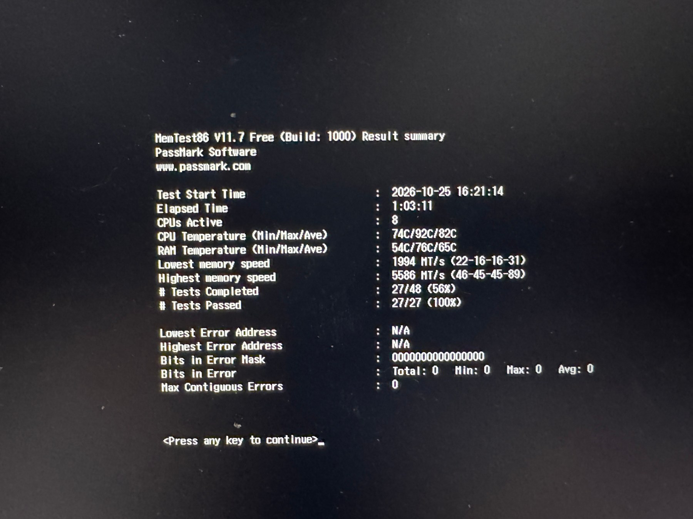

### 2. Ventoy and Parted Magic successfully started

After the Secure Boot change, Ventoy started successfully and I launched Parted Magic. I used Parted Magic's NVMe Sanitize function to prepare the internal drive for a clean installation. The utility reported **Successfully Erased** for the selected NVMe device.

The erase operation was destructive and was undertaken before installing the operating systems. The result screenshot shows the utility's reported outcome; it is not an independent forensic verification of every possible data-recovery method.

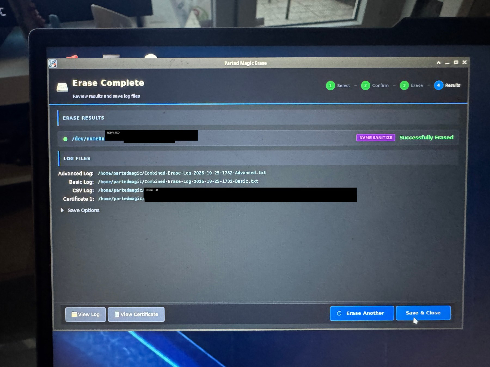

### 3. Windows installation and partition planning

I booted the Windows 11 installation media through Ventoy and selected the custom installation path. Windows Setup initially showed the approximately 953.9 GB drive as unallocated space.

To reserve space for Ubuntu, I entered **600000 MB** for the Windows partition. Windows Setup then showed a 585.7 GB primary partition and 367.9 GB of unallocated space, alongside the system and Microsoft reserved partitions it created. The displayed figures are rounded by the installer and should be read as shown in the screenshots.

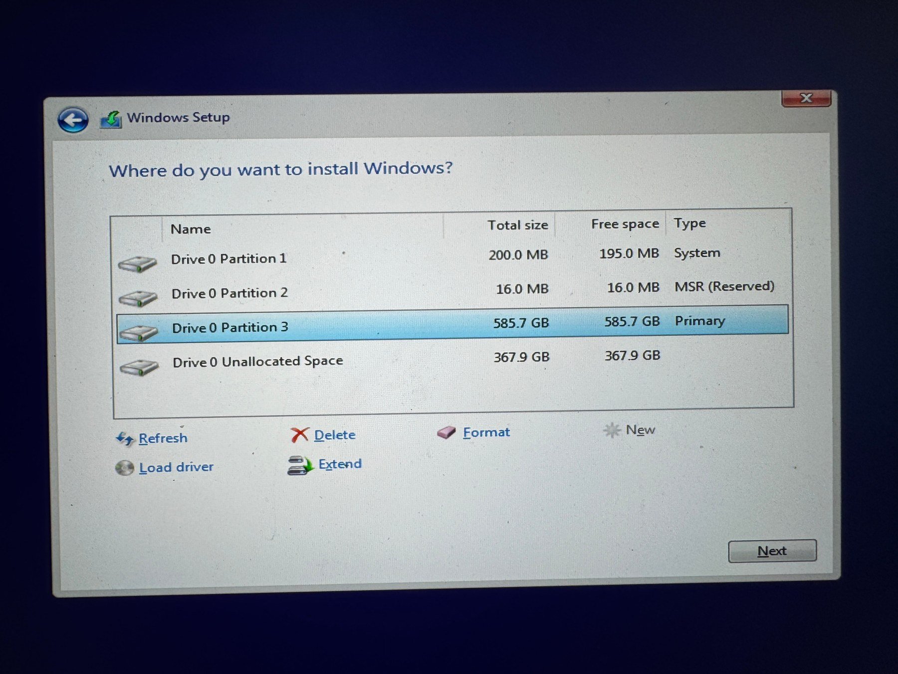

### 4. Ubuntu installed alongside Windows

I booted the Ubuntu 26.04.1 LTS installer and selected **Install Ubuntu alongside Windows Boot Manager** rather than erasing the disk. This kept the existing Windows-related partitions unchanged in the installer's summary and prepared Ubuntu partitions in the remaining space.

In the installer's encryption screen, I selected **Encrypt with a passphrase**. The installer explicitly states that this option uses LVM with LUKS encryption. I entered the passphrase privately during setup; the passphrase itself is not included in the screenshots or this documentation.

The installer summary showed the existing EFI partition used for `/boot/efi`, a new ext4 partition used for `/boot`, and the Ubuntu root installation. After installation, a later `lsblk -f` check showed the expected LUKS and LVM device layers for the root filesystem.

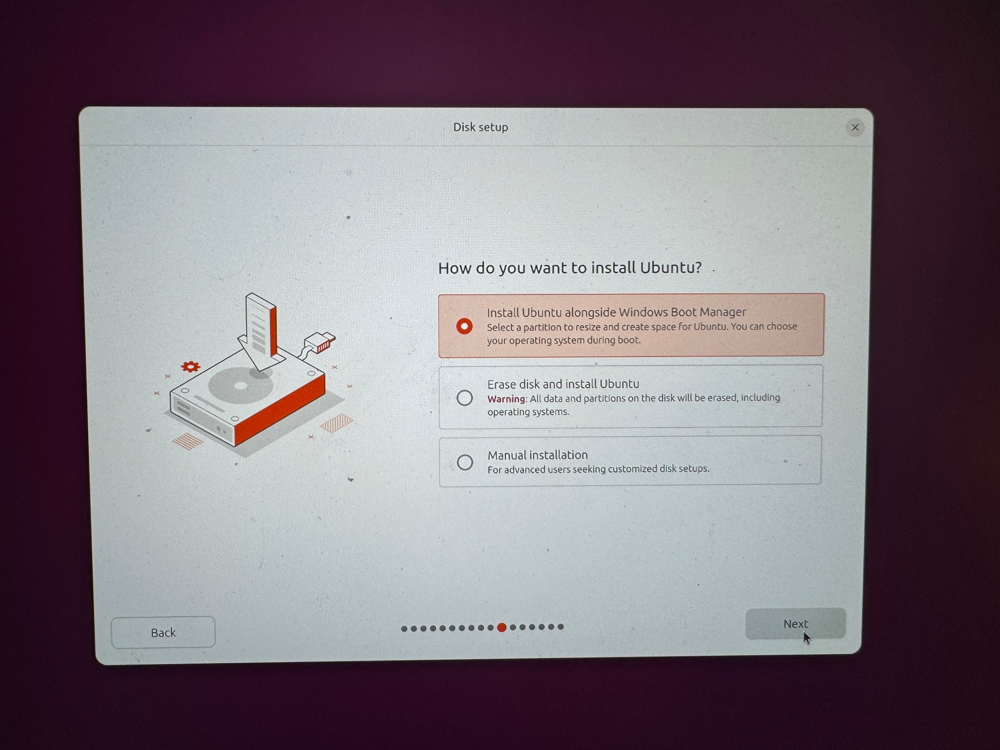

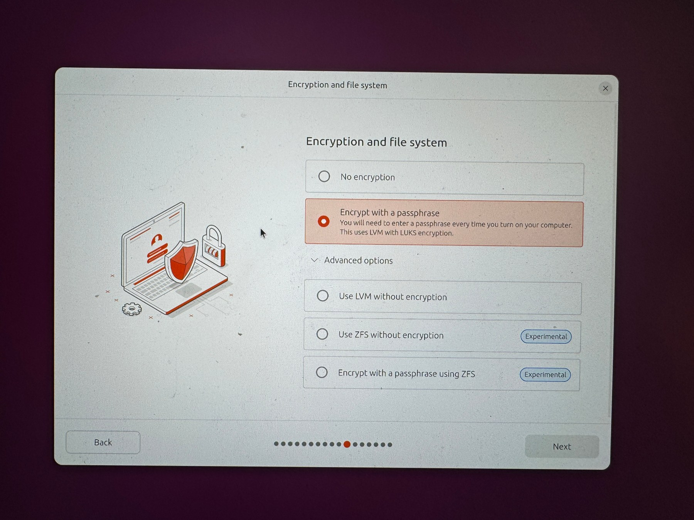

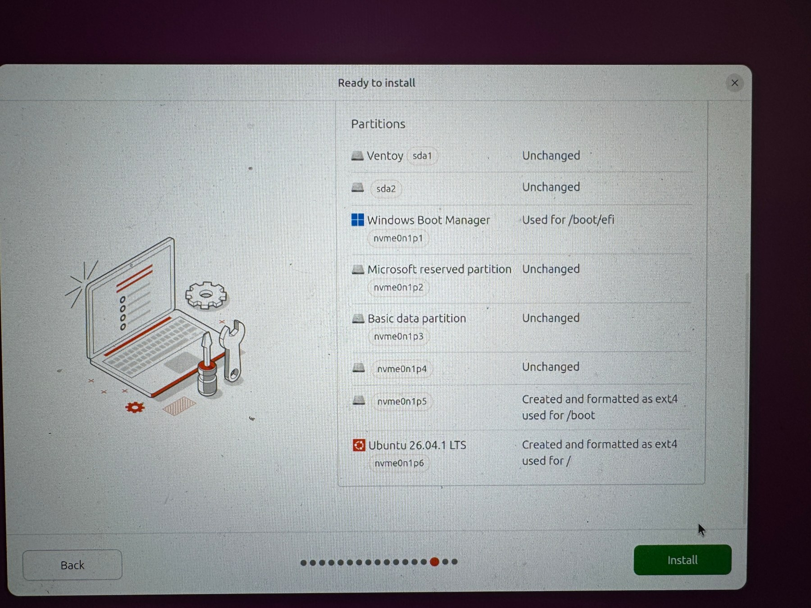

### 5. Post-installation checks: LUKS, UEFI entries and graphics

I used the following commands in Ubuntu to inspect the boot configuration and storage layout:

```bash
mokutil --sb-state
efibootmgr -v
lsblk -f
nvidia-smi
```

The captured `mokutil --sb-state` output said **SecureBoot disabled** at the time that diagnostic command was run. The `efibootmgr -v` output listed both **Windows Boot Manager** and **Ubuntu** UEFI boot entries. It also showed Ubuntu ahead of Windows in the recorded boot order at that time. The separate boot menu photograph likewise lists Ubuntu and Windows Boot Manager as selectable entries.

The `lsblk -f` output showed the following structure (UUIDs and the shell prompt have been redacted):

- `nvme0n1p1`: FAT32 EFI system partition mounted at `/boot/efi`.
- `nvme0n1p5`: ext4 partition mounted at `/boot`.
- `nvme0n1p6`: `crypto_LUKS` encrypted partition.
- The mapped device underneath the LUKS partition is an LVM physical volume.
- The `ubuntu--vg-ubuntu--lv` logical volume contains an ext4 filesystem mounted at `/`.

This is evidence that the installed Ubuntu root filesystem was arranged inside the LUKS/LVM stack selected during installation. The screenshot of `nvidia-smi` also showed the NVIDIA driver communicating with the GeForce RTX 4070 Laptop GPU; that check is a supporting post-installation observation, not a Secure Boot test.

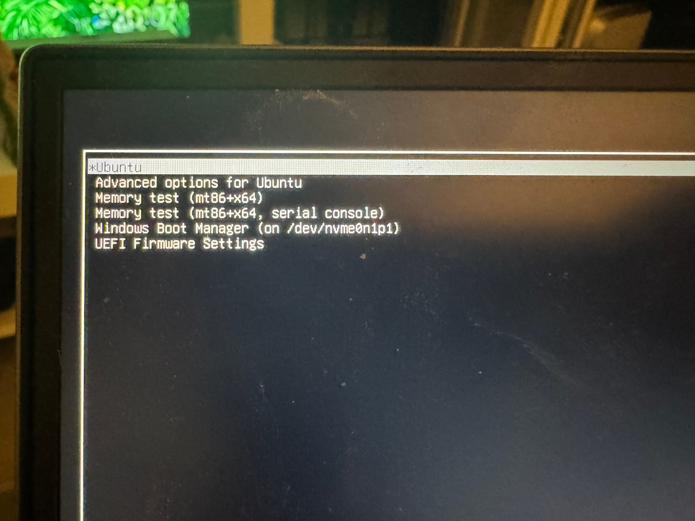

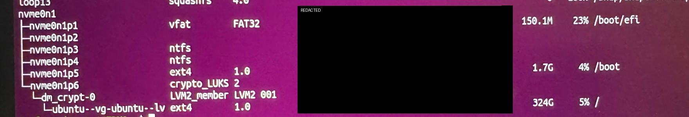


The captured `efibootmgr -v` output included the following sanitized excerpt (unique device-path and GUID data omitted):

```text
BootOrder: 0002,0001,2001,2002,2003
Boot0001* Windows Boot Manager
Boot0002* Ubuntu
```

### 6. BitLocker troubleshooting in Windows

The Windows work included a separate BitLocker issue. An initial enablement attempt failed with a message stating that the TPM could not unlock the drive and that `C:` was not encrypted.

I checked TPM status with `Get-Tpm`, Windows Recovery Environment status with `reagentc /info`, and the drive state with `manage-bde -status C:`. During this investigation, the drive was reported as fully decrypted, with protection off and no key protectors listed.

The key finding from this troubleshooting sequence was that **BitLocker only completed successfully after I re-enabled Secure Boot in UEFI/BIOS**. Once Secure Boot was enabled again, I retried BitLocker and the encryption process progressed to completion.

The final `manage-bde -status C:` output reports:

- Conversion status: Fully Encrypted
- Percentage encrypted: 100.0%
- Encryption method: XTS-AES 128
- Protection status: Protection On
- Key protectors listed: TPM and Numerical Password

#### BitLocker and Secure Boot: observed relationship

In this installation, re-enabling Secure Boot was the change that preceded successful BitLocker encryption. This is technically plausible and consistent with Microsoft's documentation.

Microsoft documents that BitLocker can use Secure Boot as a platform-integrity provider when the device supports it and the relevant policy permits it. The TPM's **Platform Configuration Register (PCR) 7** measures the Secure Boot state. Microsoft also documents that UEFI Secure Boot must be enabled for BitLocker Automatic Device Encryption, including silent device-encryption scenarios.

These details provide a credible technical explanation for why Secure Boot may have mattered in this case. However, the available evidence does not establish whether the initial failure was specifically caused by PCR 7 measurements, an encryption-provisioning requirement, a policy setting, or another TPM/boot-configuration condition.

The report therefore records the observed sequence: the initial attempt failed, Secure Boot was re-enabled, and BitLocker then completed successfully. This is the result observed on this laptop, **not a claim that Secure Boot is an absolute requirement for every possible BitLocker configuration**.

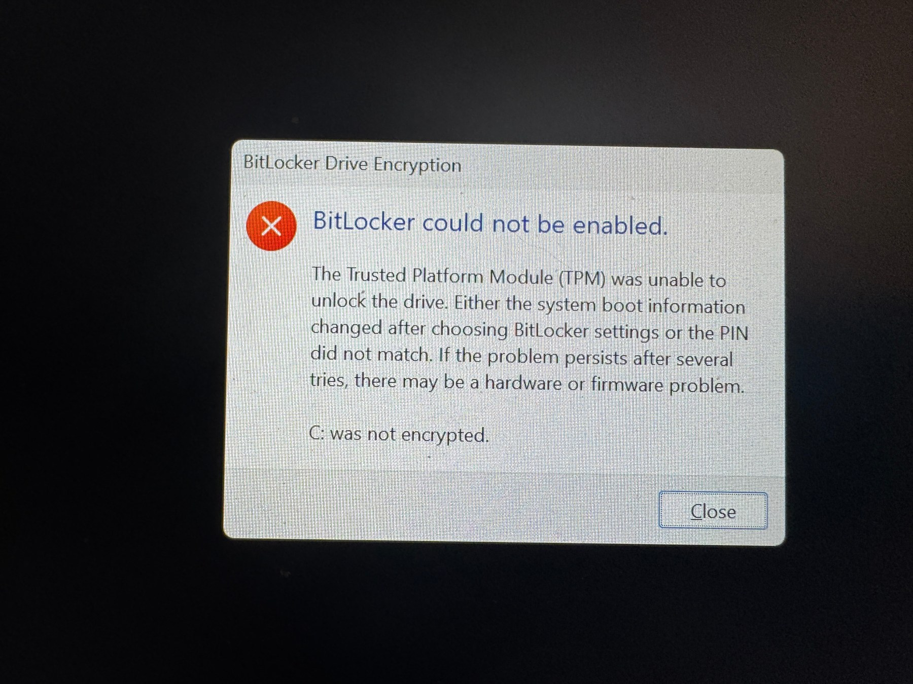

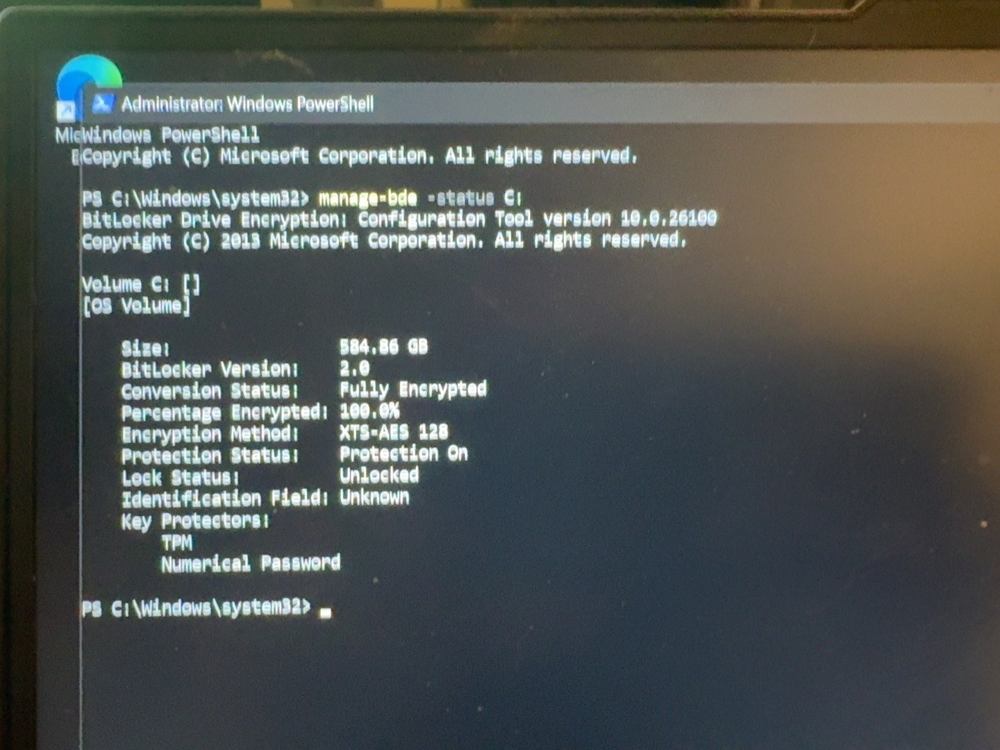

## Final verification and limitations

After installing both operating systems, I re-enabled Secure Boot in UEFI/BIOS. BitLocker only completed successfully after I made this change: Windows subsequently reported the C: drive as fully encrypted, with XTS-AES 128, protection on, and TPM and Numerical Password key protectors.

With Secure Boot enabled again, I also confirmed that **both Windows and Ubuntu booted normally**. These final outcomes are recorded from my account of the tests performed.

I did not capture a photograph of the BIOS with Secure Boot disabled, nor a photograph of the final BIOS screen after Secure Boot was re-enabled. The available images therefore show the earlier enabled state and a later diagnostic check reporting disabled, while the final re-enabled state, successful BitLocker encryption, and successful boots are described from the tests I performed. The report does not present the earlier BIOS photograph or the disabled-state command output as proof of the final setting.

Other limitations:

- The MemTest86 run was incomplete; zero errors were reported during the captured portion, but this was not a completed four-pass validation.
- The precise initial Ventoy key-error message was not photographed, and its root cause was not conclusively established.
- BitLocker only completed after Secure Boot was re-enabled in this installation. Microsoft's documentation explains why Secure Boot can be relevant to BitLocker integrity validation and automatic device encryption, but the exact TPM/boot-measurement mechanism behind this initial failure was not independently isolated.
- This project verifies booting and selected storage/encryption states; it is not a full recovery test for either operating system.

## Lessons learned

- An issue booting one piece of USB media with Secure Boot enabled does not by itself prove that Secure Boot must remain disabled for the installed operating systems.
- If troubleshooting requires a temporary firmware change, record the original state, keep track of temporary changes, and verify the intended final state afterward.
- Planning disk space before installing the first operating system makes a same-drive dual-boot setup easier to manage.
- Check the actual post-installation storage layers rather than relying solely on installer selections; `lsblk -f` helped verify the LUKS/LVM structure.
- For BitLocker, distinguish a failed enablement attempt from a confirmed encrypted state. In this case, re-enabling Secure Boot preceded successful encryption; `manage-bde -status` confirmed completion rather than relying only on the progress dialog.
- Screenshots, command output, and explicit limitations make troubleshooting documentation more useful and trustworthy.

## References

- [Microsoft Learn: Configure BitLocker — Allow Secure Boot for integrity validation](https://learn.microsoft.com/en-us/windows/security/operating-system-security/data-protection/bitlocker/configure)
- [Microsoft Learn: BitLocker drive encryption in Windows 11 for OEMs — automatic device-encryption requirements](https://learn.microsoft.com/en-us/windows-hardware/design/device-experiences/oem-bitlocker)
- [Microsoft Learn: Enforcing BitLocker policies by using Intune — Secure Boot, PCR 7 and silent encryption](https://learn.microsoft.com/en-us/troubleshoot/windows-client/windows-security/enforcing-bitlocker-policies-by-using-intune-known-issues)

## Safety note

This portfolio documents experiments in a personal learning environment. Hardware, storage, and system-configuration changes may cause data loss or service disruption if applied incorrectly. Review the instructions carefully, verify commands and device identifiers, and maintain appropriate backups before reproducing a procedure. **Proceed at your own risk!**

Sensitive information has been excluded or redacted from the public evidence copies.
